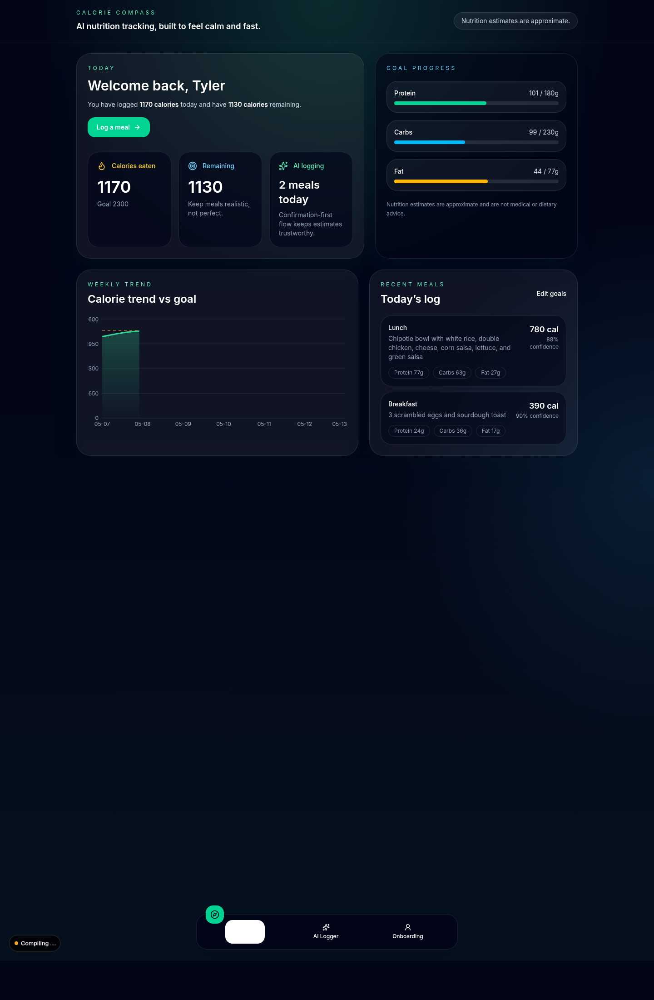
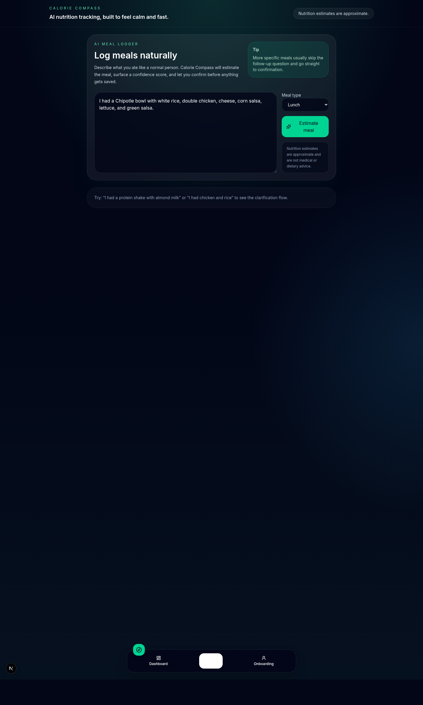

# MacroMesh / Calorie Compass

**AI-assisted nutrition logging for web and iOS — designed around reviewable food data, not blind model guesses.**

[Live web application](https://calorie-compass-chi.vercel.app/) · [Portfolio](https://tyler-portfolio-site.vercel.app/) · [Architecture](docs/food-intelligence/ARCHITECTURE.md)

This independent software engineering project combines **Next.js, React, TypeScript, SwiftUI, PostgreSQL, Prisma, and the OpenAI API** to help users log meals conversationally, review proposed entries before saving, track history, and understand nutrition trends. The codebase includes the web application and native iOS client.

## Engineering highlights

- **Cross-platform product:** Built web and SwiftUI iOS experiences for natural-language meal logging, review-before-save, history, and progress tracking.
- **Multi-source resolution:** Combined a verified food catalog, USDA FoodData Central, Open Food Facts, and LLM-assisted fallback with structured validation and source labeling. Provider availability depends on configuration.
- **Data integrity:** Applied idempotency keys, database uniqueness constraints, and Prisma transactions to protect saved meal records from duplicate requests.
- **Testing and release discipline:** Added automated tests for food matching, meal corrections, provider behavior, validation, and save conflicts, supported by documented deployment checks and TestFlight workflows.

## Evidence and engineering decisions

| Engineering problem | Approach |
| --- | --- |
| A language model may produce inaccurate food details | Normalize the user request, prefer verified/provider records, validate candidates, and allow corrections before saving |
| Different providers return overlapping or ambiguous results | Centralize candidate normalization, ranking, and confidence/review checks |
| A save request may be repeated | Enforce idempotency and transaction-safe uniqueness constraints |
| Changes may break prior matching behavior | Keep fixed benchmarks, regression tests, and release gates |

An internal fixed branded-food benchmark improved from **3/25 to 21/25 passing cases**. A separately recorded **offline test benchmark passed 1,000/1,000 cases** on its documented run. These metrics describe internal tests, **not 100% real-world nutrition accuracy**.

For deeper implementation details, see [Food Intelligence architecture](docs/food-intelligence/ARCHITECTURE.md), [food resolution pipeline](docs/FOOD_RESOLUTION_PIPELINE.md), [benchmark record](docs/benchmarks/nutrition-accuracy-baseline.md), and [release checklist](docs/RELEASE_CHECKLIST.md).

## Product screenshots

| Dashboard | Meal logging |
| --- | --- |
|  |  |

## Technology

**Frontend:** Next.js App Router, React, TypeScript, Tailwind CSS; native iOS with SwiftUI  
**Data/backend:** PostgreSQL, Prisma, REST/JSON integrations, transactional persistence  
**AI:** OpenAI API for language interpretation and structured assistant interactions  
**Engineering tools:** Vitest, ESLint, GitHub, Vercel, Codemagic, TestFlight

## Local development

```bash
npm install
cp .env.example .env
npx prisma migrate dev
npx prisma db seed
npm run dev
```

Configure a writable PostgreSQL database and any required provider credentials as described in [`.env.example`](.env.example). Do not commit secrets. Without an OpenAI key, the meal parser supports a deterministic development fallback. Production persistence requires a writable database.

## Testing

```bash
npm test
npm run lint
npm run build
npm run qa:assistant
npm run test:food-intelligence
npm run test:food-search
npm run scan:secrets
npm run predeploy:check
```

Some suites need environment setup or external service credentials. These commands are documented repository checks, **not** a claim that every test was run while editing this README.

> Nutrition values can be estimated or incomplete. This software is not medical or dietary advice.

---

**Tyler Cox** · The Ohio State University · B.S. Computer Science & Engineering, expected **May 2027**  
**Contact:** [cox.1644@osu.edu](mailto:cox.1644@osu.edu) · [LinkedIn](https://www.linkedin.com/in/tyler-cox-53b886406) · [GitHub](https://github.com/TyCodes101)
